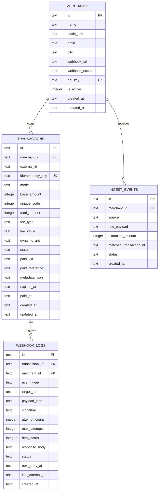

# Entity Relationship Diagram (ERD) & Database Schema

## 1. Diagram Relasi Entitas



---

## 2. SQLite / PostgreSQL DDL Reference

```sql
CREATE TABLE merchants (
  id TEXT PRIMARY KEY,
  name TEXT NOT NULL,
  static_qris TEXT NOT NULL,
  nmid TEXT,
  city TEXT,
  webhook_url TEXT,
  webhook_secret TEXT NOT NULL,
  api_key TEXT NOT NULL UNIQUE,
  is_active INTEGER NOT NULL DEFAULT 1,
  created_at TEXT NOT NULL,
  updated_at TEXT NOT NULL
);

CREATE TABLE transactions (
  id TEXT PRIMARY KEY,
  merchant_id TEXT NOT NULL REFERENCES merchants(id) ON DELETE CASCADE,
  external_id TEXT,
  idempotency_key TEXT UNIQUE,
  mode TEXT NOT NULL DEFAULT 'MPM', -- MPM | CPM
  base_amount INTEGER NOT NULL,
  unique_code INTEGER NOT NULL DEFAULT 0,
  total_amount INTEGER NOT NULL,
  fee_type TEXT,
  fee_value REAL,
  dynamic_qris TEXT NOT NULL,
  status TEXT NOT NULL DEFAULT 'PENDING', -- PENDING | PAID | EXPIRED | FAILED
  paid_via TEXT,
  paid_reference TEXT,
  metadata_json TEXT,
  expires_at TEXT NOT NULL,
  paid_at TEXT,
  created_at TEXT NOT NULL,
  updated_at TEXT NOT NULL
);

CREATE INDEX idx_tx_merchant_status_amount ON transactions(merchant_id, status, total_amount);
CREATE INDEX idx_tx_expires ON transactions(status, expires_at);

CREATE TABLE webhook_logs (
  id TEXT PRIMARY KEY,
  transaction_id TEXT NOT NULL REFERENCES transactions(id) ON DELETE CASCADE,
  merchant_id TEXT NOT NULL REFERENCES merchants(id) ON DELETE CASCADE,
  event_type TEXT NOT NULL,
  target_url TEXT NOT NULL,
  payload_json TEXT NOT NULL,
  signature TEXT NOT NULL,
  attempt_count INTEGER NOT NULL DEFAULT 0,
  max_attempts INTEGER NOT NULL DEFAULT 5,
  http_status INTEGER,
  response_body TEXT,
  status TEXT NOT NULL DEFAULT 'PENDING', -- PENDING | DELIVERED | FAILED
  next_retry_at TEXT,
  last_attempt_at TEXT,
  created_at TEXT NOT NULL
);

CREATE TABLE ingest_events (
  id TEXT PRIMARY KEY,
  merchant_id TEXT NOT NULL REFERENCES merchants(id) ON DELETE CASCADE,
  source TEXT NOT NULL,
  raw_payload TEXT NOT NULL,
  extracted_amount INTEGER,
  matched_transaction_id TEXT,
  status TEXT NOT NULL, -- MATCHED | UNMATCHED | DUPLICATE
  created_at TEXT NOT NULL
);
```
